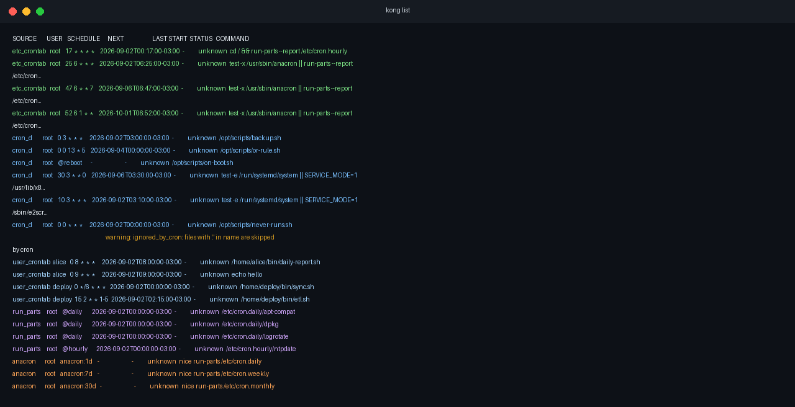
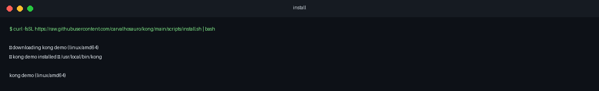
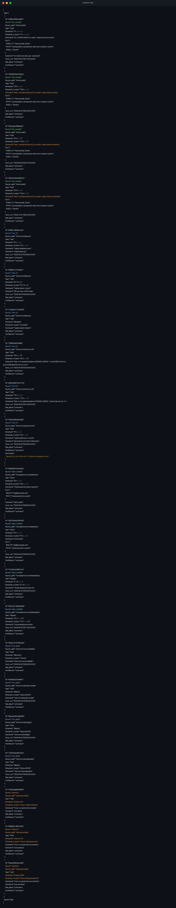

<p align="center">
  <strong>kong</strong><br>
  <em>every cron job on your Linux box, one command</em>
</p>

<p align="center">
  <a href="LICENSE"></a>
  
  
  
</p>

<p align="center">
  
</p>

---

It's 2am. Something broke on a bare-metal box. Someone asks what cron jobs run there.

You check `/etc/crontab`. Then `/etc/cron.d/`. Then a user spool you forgot about. Then `systemctl list-timers`. Then syslog, if the log is still there.

Forty-five minutes later you might know what's scheduled. You still don't know when each job runs next, or whether the last run actually finished.

kong is a small CLI I wrote for that. One static binary, no agent, no database, no SaaS account.

```bash
curl -fsSL https://raw.githubusercontent.com/carvalhosauro/kong/main/scripts/install.sh | bash
kong list
```

<p align="center">
  
</p>

---

## What cron actually tells you

Cron fires your command and moves on. It does not keep execution history.

| Question | Cron | kong (V0) |
|----------|:----:|:---------:|
| What's scheduled here? | spread across 6+ places | `kong list` |
| When does it run next? | you figure it out | computed |
| Did the last run succeed? | no exit code, no duration | V2 (`kongwrap`) |

Syslog might say the job started. It won't tell you if it finished, or with what exit code. Output goes to `MAILTO`. No MTA configured? Gone.

kong does not replace cron. It just makes the schedule readable.

---

## Install

```bash
curl -fsSL https://raw.githubusercontent.com/carvalhosauro/kong/main/scripts/install.sh | bash
```

Works on bare metal, VPS, homelab. No root required (falls back to `~/.local/bin`). No Docker. You can also `scp` the binary.

<details>
<summary>Other install options</summary>

```bash
# Pin a version
KONG_VERSION=v0.1.0 curl -fsSL https://raw.githubusercontent.com/carvalhosauro/kong/main/scripts/install.sh | bash

# User install (no sudo)
KONG_INSTALL_DIR=$HOME/.local/bin curl -fsSL https://raw.githubusercontent.com/carvalhosauro/kong/main/scripts/install.sh | bash

# From source
go install github.com/carvalhosauro/kong/cmd/kong@latest

# Manual download (after GitHub release)
curl -LO https://github.com/carvalhosauro/kong/releases/download/v0.1.0/kong_0.1.0_linux_amd64.tar.gz
tar xzf kong_0.1.0_linux_amd64.tar.gz && sudo mv kong /usr/local/bin/
```

</details>

> Push tag `v0.1.0` to GitHub first. The install script downloads binaries from [Releases](https://github.com/carvalhosauro/kong/releases). Until then, use `go install`.

<details>
<summary>Install requirements</summary>

### On GitHub

| Requirement | Why |
|-------------|-----|
| Public repo at `github.com/carvalhosauro/kong` | `raw.githubusercontent.com` serves `install.sh` |
| Branch `main` with `scripts/install.sh` | what `curl` downloads |
| At least one release (e.g. `v0.1.0`) | script pulls binary from `releases/download/` |
| Artifacts named `kong_<version>_linux_<arch>.tar.gz` | built by release workflow |

Without a published release: `could not resolve latest release from GitHub`.

### On the host

| Requirement | Required |
|-------------|:--------:|
| Linux | yes |
| amd64 or arm64 | yes |
| curl, tar, bash | yes |
| grep | yes (only with `latest`) |
| HTTPS to github.com and raw.githubusercontent.com | yes |
| root | no |
| Go, Docker, agent | no |

Installs to `/usr/local/bin` (with `sudo` if needed) or `~/.local/bin`. If using the latter:

```bash
export PATH="$HOME/.local/bin:$PATH"
```

</details>

<details>
<summary>Upgrading</summary>

Same command as install. Overwrites the existing binary.

```bash
curl -fsSL https://raw.githubusercontent.com/carvalhosauro/kong/main/scripts/install.sh | bash
```

Defaults to the latest release (`KONG_VERSION=latest`).

```bash
kong version

KONG_VERSION=v0.2.0 curl -fsSL https://raw.githubusercontent.com/carvalhosauro/kong/main/scripts/install.sh | bash

KONG_INSTALL_DIR=/usr/local/bin curl -fsSL https://raw.githubusercontent.com/carvalhosauro/kong/main/scripts/install.sh | bash
```

</details>

---

## JSON output

```bash
kong list --json | jq '.jobs[] | select(.warnings != null)'
kong list --user deploy --json
kong list --source cron_d
```

<p align="center">
  
</p>

---

## Sources it reads

| Source | Path | Notes |
|--------|------|-------|
| User crontabs | `/var/spool/cron/crontabs/*` (Debian), `/var/spool/cron/*` (RHEL) | other users need root |
| System crontab | `/etc/crontab` | extra user field |
| Drop-ins | `/etc/cron.d/*` | warns on `*.conf` (cron ignores them) |
| run-parts | `/etc/cron.{hourly,daily,weekly,monthly}/*` | individual scripts |
| anacron | `/etc/anacrontab` | laptops, intermittent uptime |
| systemd timers | `systemctl` | last run status from systemd |

Debian, Ubuntu, RHEL, Fedora, Arch. Read-only. Never writes.

---

## How I use it

I run cron on real machines, not k8s CronJobs. When something breaks at night, I don't want to grep six directories.

```bash
ssh prod-worker-03
kong list
kong list --json | jq '.jobs[] | select(.command | contains("backup"))'
kong list --json | jq '.partial, .inaccessible_sources'
```

No agent on every host. No central server. One binary, or run it over SSH when you need it.

---

## Compared to...

| Tool | Good at | Misses |
|------|---------|--------|
| `crontab -l` | one user's jobs | `/etc/cron.d`, anacron, timers |
| `systemctl list-timers` | systemd | classic cron |
| Healthchecks.io | dead man's switch | needs network + per-job curl |
| Cronitor | monitoring | paid, cloud |
| kong | full local inventory, offline, one binary | V0 is inventory only; V2 adds exit codes |

---

## Internals

```
/etc/crontab ──┐
/etc/cron.d/* ─┤
/var/spool/cron┼──► collect ──► schedule.Next() ──► table / JSON
/etc/cron.daily┤         ▲
anacrontab ────┤         └── journalctl (last start, best-effort)
systemctl ─────┘
```

~2.7 MB static binary (`CGO_ENABLED=0`). No daemon. Works without root (marks `partial: true` when it can't read other users' spools).

Also catches things easy to miss: `@reboot` has no next run, `cron.d/*.conf` is silently ignored, `%` in commands is stdin not literal text.

---

## Roadmap

| Version | What | Status |
|---------|------|--------|
| V0 | `kong list` | done |
| V1 | TUI (search, filters, vim keys) | planned |
| V2 | `kongwrap` (exit codes + SQLite history) | planned |
| V3 | webhooks, fleet view | later |

V2 adds a wrapper that records real exit codes without breaking existing cron behavior:

```cron
* * * * * /usr/local/bin/kongwrap --id backup -- /opt/scripts/backup.sh
```

Same exit code. Same stdout. History on disk.

---

## Commands

```
kong list [flags]     list scheduled jobs
kong version          print version

Flags:
  --json              JSON output
  --user USER         filter by user
  --source SOURCE     user_crontab | etc_crontab | cron_d | run_parts | anacron | systemd_timer
  --fs-root PATH      path prefix (for fixtures/tests)
```

---

## Develop

```bash
git clone https://github.com/carvalhosauro/kong.git && cd kong
make build && make test
./bin/kong list --fs-root testdata/fixtures/debian-12
```

### Regenerate README screenshots

Runs a Debian container with sample cron jobs, executes kong, renders PNGs to `docs/screenshots/`:

```bash
make screenshots   # requires Docker + python3-pillow
```

### Release

Tag `v0.1.0`, GitHub Actions builds linux/amd64 + arm64 tarballs, install script works.

```bash
git tag v0.1.0 && git push origin v0.1.0
```

---

## Setting up the GitHub repo

Checklist to publish and enable `curl | bash`:

### 1. Create the repo

GitHub: New repository, name `kong`, public, no README (you have one locally).

```bash
cd /path/to/kong
git remote add origin https://github.com/carvalhosauro/kong.git
git add -A
git commit -m "Initial release: kong V0 inventory CLI"
git branch -M main
git push -u origin main
```

### 2. About section

| Field | Suggestion |
|-------|------------|
| Description | `See every cron job on your Linux box, one static binary` |
| Topics | `cron`, `linux`, `devops`, `cli`, `monitoring`, `go`, `bare-metal` |

### 3. First release

```bash
git tag v0.1.0
git push origin v0.1.0
```

Publishes `kong_0.1.0_linux_amd64.tar.gz` and `kong_0.1.0_linux_arm64.tar.gz` (+ sha256). Check Releases before testing install in prod.

### 4. CI

`.github/workflows/ci.yml` runs `go test` and `go vet` on push/PR. Nothing else to configure.

### 5. Layout

```
kong/
├── cmd/kong/
├── internal/collect/    # collectors (testable, fsRoot)
├── internal/schedule/
├── internal/render/
├── internal/model/
├── docker/demo/         # container for README screenshots
├── scripts/install.sh
├── docs/screenshots/
├── testdata/fixtures/
├── .github/workflows/
├── Makefile
├── LICENSE
└── README.md
```

`internal/collect` does not know about UI. CLI and future TUI are clients of the same core.

### 6. Future releases

```bash
git tag v0.2.0 && git push origin v0.2.0
```

Users update with the same `curl | bash`.

### 7. Skip for now

Wiki, Discord, separate website. Branch protection until you have contributors.

---

## Known limits

- DST: cron is weird here; kong documents it, does not fix it
- Classic cron last-start: inferred from syslog/journal (`confidence: inferred`), start time only
- `@reboot`: no predictable next run (shown as `-`)

---

<p align="center">
  kong: cron + go, minus the archaeology
</p>
